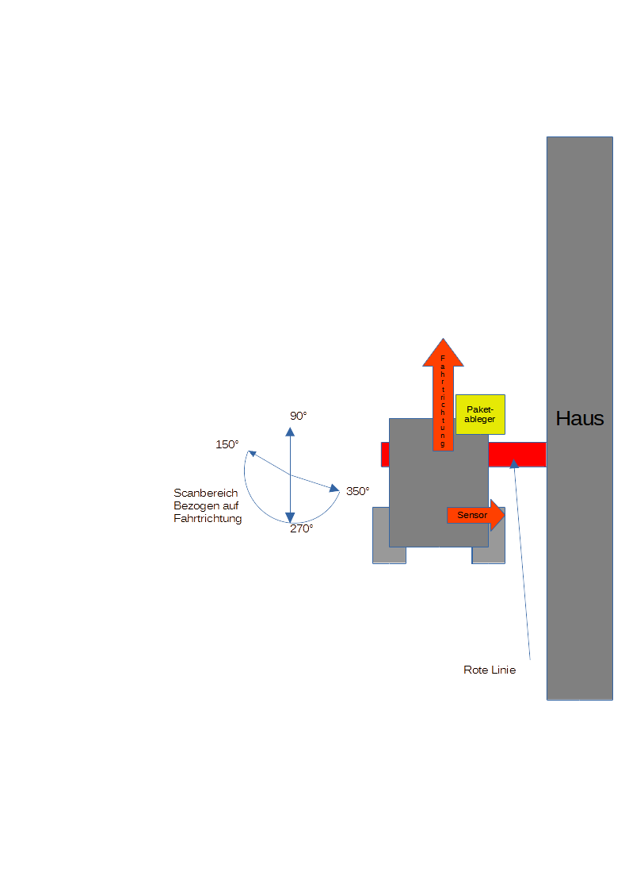
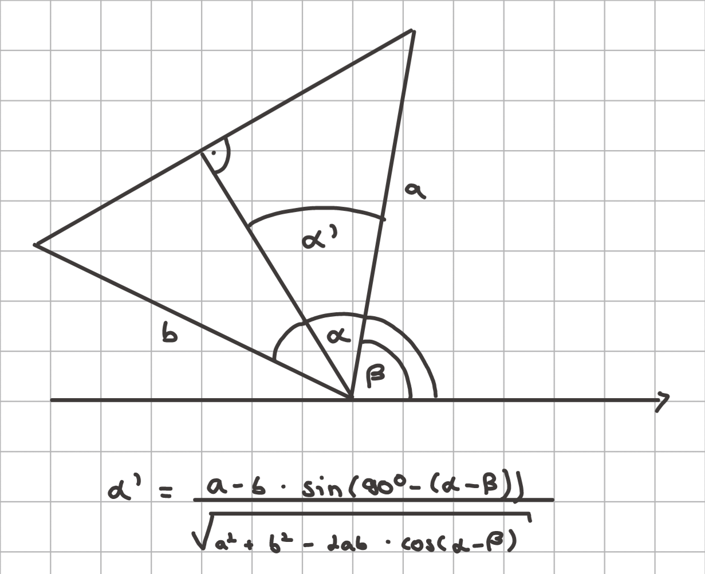
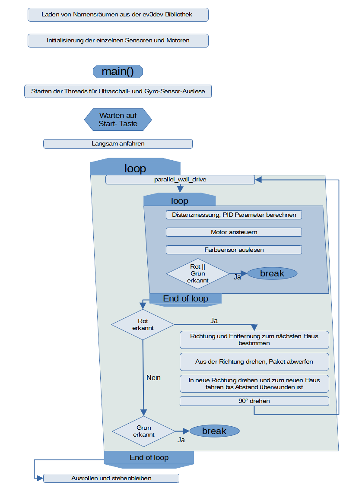

# Roborace 2024 - Lösung - MPG Happy Hippos

Eine mögliche Lösung zur Aufgabe des diesjährigen Roborace Stuttgart mit Hilfe der ev3dev2 Python Bibliothek.


[](https://www.ev3dev.org)

## Voraussetzungen

Es gibt verschiedene Entwicklungsumgebungen zur Entwicklung von Software zur Steuerung des auf dem EV3 basiernden Roboter.
Eine kleine Auswahl textbasierter Programmiersprachen stellen z.B.

- LeJOS
- MonoBrick
- c4ev3
- EV3 Basic
- ROBOTC
- ev3dev
- Pybricks

dar.

Wir haben auf die Nutzung kostenpflichtiger Lösungen verzichtet.</br>
Da wir mit der EV3 Programmierung zu Beginn des Projektes nicht vertraut waren, haben wir uns für eine Lösung entschieden, die eine komplette Umgebung sowohl auf dem EV3 als auch für zur Programmierung genutzten Host PC bereitstellte und über eine gut nachvollziehbare Dokumentation verfügte. Insbesondere der letzte Punkt war wichtig.</br>
Wir haben uns für **ev3dev** entschieden, da es ein auf eine SD Karte flashbares Betriebsystem (steht als image zur Verfügung) bereitstellt und auf der Host PC Seite durch eine passende VS-CODE Extension zur Programmierung ergänzt wird.
Das ev3dev zugrunde liegende Betriebssystem ist ein Debian basiertes Linux es kann für mehrere LEGO® MINDSTORMS kompatible Platformen wie EV3 oder Raspberry Pi verwendet werden.</br>
ev3dev unterstützt verschieden Programmiersprachen z.B. C++, Go, Java, MicroPython, Python und andere mehr.</br>
Die Nutzung von Python als Programmiersprache war für uns ein weiterer Vorteil, da Python-Kenntnisse vorhanden waren und Python eine schnell zu erlernende Programmiersprache ist.

## Funktionen

Der Roboter wurde als automatischer Lieferroboter programmiert.

Detaillierte Erklärungen zur Aufgabe können im [Anhang](#anhang) "Aufgabenstellung" und auf [der Homepage der Universität Stuttgart](https://www.ist.uni-stuttgart.de/de/lehre/roborace/aufgabe/) gefunden werden.

### Zentrale Funktionen

- entlang von Wänden und Ecken fahren (mithilfe eines PID-Reglers [[2](#lit_zwei)])
- andere Häuser finden
- zu anderen Häusern fahren (optimaler Kurs wird mithilfe von Trigonometrie berechnet)

### Weitere Funktionen

- Töne abspielen
- unterschiedliche Gradzahl drehen (sowohl relativ zur aktuellen als auch zur ursprünglichen Position)
- Pakete abwerfen

## Code Erklärung

Die Kontrolle des Roboters erfolgt mittels mehrerer ineinander verschachtelter Schleifen und paralleler Threads.
Eine graphische Zusammenfassung des Programmflusses befindet sich im Anhang als [Flussdiagramm](#flussdiagramm).

In den Threads werden die Sensorwerte des Ultraschallsensors zur Abstandserfassung und des Gyrosensors zur Winkelerfassung ausgelesen, aufbereitet und den Routinen des Hauptprogramms (main) mittels Klassen zur Verfügung gestellt.</br>
Das Auslesen und Aufbereiten der Sensorwerte erfolgt in parallelen Threads, um den Ablauf in der Hauptschleife nicht durch diese Aufgaben zu verzögern.

Der Farbsensor wird direkt aus dem Hauptprogramm angesprochen.

Aus Gründen der Vereinfachung wurde auf eine zusätzliche Mittelschicht (middleware), die eine Abarbeitung in festen Zeitrastern und Bibliotheksunabhängigkeit zur Hardware-Ansteuerung ermöglichte, verzichtet. Gleiches gilt für den Verzicht auf ein Hardware spezifisches Betriebssystem (OS, Robo-OS).

### Strategie

Der Roboter fährt an der Wand eines Hauses entlang, bis der Farbsensor eine rote Linie erkennt. Während der Fahrt versucht der Roboter mit Hilfe des Abstandsensors einen Abstand von 13cm zur Wand zu halten.
Sobald die Rote Linie detektiert wurde hält der Roboter an. Es folgt eine Drehung, die einen Winkelbereich von ~180° abdeckt.



Während der Drehung wird kontinuierlich der Abstand erfasst und ausgewertet. Über eine Kantenerkennung werden die Positionen der Ecken der in der Nähe stehenden Häuser erfasst und deren Abstände und Winkel in einem Dictionary gespeichert.

Die Wand mit dem kürzesten Abstand soll im rechten Winkel angefahren werden. Dieser Ansteuerwinkel wird mittels Cosinussatz errechnet.

```python
anOfAprch = ((((a - b * math.sin(math.radians(90-(beta-alpha)))) / math.sqrt(((a*a) + (b*b)) - (2*a*b * math.cos(math.radians((beta-alpha)))))) * 180 / math.pi) + alpha) - 90
```

<span class="caption">[*modules/detect__houses_advanced.py, Line: 183*](modules/detect_houses_advanced.py)



beta ist der Winkel des Sensors bei der ersten Ecke relativ zur Hauswand, alpha ist der Winkel des Sensors bei der zweiten Ecke relativ zur Hauswand, a ist die Distanz bis zur ersten Ecke, b die Distanz bis zur zweiten Ecke, alpha' ist der Winkel, den man über beta hinausgehen muss, um auf der Senkrechten der Hauswand zu sein.
Bevor die nächste Hauswand angefahren wird, wird jedoch noch das Paket abgeworfen. Damit der Roboter nicht über das abgeworfene Paket fährt, dreht er sich kurz in Richtung Hauswand, läßt das Paket fallen und steuert dann die nächste Wand an.

Da der Sensor um 90° zur Fahrtrichtung gedreht ist, kann er während des Anfahrens der Wand des nächsten Hauses keine Distanzdaten zu dieser liefern. Darum wird, ebenfalls mit Trigonometrie, die Distanz zur nächsten Wand berechnet.

```python
distToNextHouse = abs(math.cos(anOfAprch - alpha)) * a
```

<span class="caption">[*modules/detect__houses_advanced.py, Line: 193*](modules/detect_houses_advanced.py)

Von dieser berechneten Distanz wird noch der Sollabstand abgezogen, damit der Roboter nicht mit der Wand kollidiert (da eine Kollision mit einem Haus im Wettbewerb zu einer Zeitstrafe führt).

Während des Wettbewerbs hat sich die Sensorausrichtung von 90° zur Fahrtrichtung als unvorteilhaft herausgestellt.
Ein um 45° gedrehter Sensor ermöglichte eine robustere Regelung.
Ein separat drehbarer Sensor, welche im Wettbewerb auch vorkamen, ermöglichte eine schnellere Häusererfassung, benötigt aber eine zusätzliche Abstimmung zwischen Sensordrehwinkel und Fahrzeugrichtung.</br>
Leider reichte die Zeit nicht mehr diese Ansätze auszuprobieren.

### Entlang von Wänden und Ecken fahren

Folgendes ist die Grundlage für das Entlangfahren an Wänden. Das Programm nutzt die Differenz zwischen der aktuellen Distanz zu einem Haus und der Distanz, die der Roboter haben soll, und setzt diese in eine PID-Regler-Formel ein. Die Funktionsweise eines PID-Reglers ist in [[2](#lit_zwei)] "Was ist ein PID-Regler" beschrieben. Der Ausgabewert "turnratio" wird dann zur Steuerung genutzt.

<!-- ```python
error = ultrasonic_sensor.distance_centimeters - goal
integral += (error * deltaTime)
derivative = (error - previous_error) / deltaTime

turnratio = (kp * error) + (ki * integral) + (kd * derivative)

steering_drive.on(turnratio, 20)
``` -->

```python
        current_time = time.time()
        delta_time = current_time - previous_time

        error = angles_dists_thread.ThreadOutput.dist - goal
        integral += stopint*(error * delta_time)
        derivative = (error - previous_error) / delta_time
        ...
        #calculate turnratio with pid-algorithm
        turnratio = (kp * error) + (ki * integral) + (kd * derivative)
        turnratio_calculated = turnratio
        ...
        #plug value calculated by pid-algorithm into steering function
        steering_drive.on(turnratio, -20)

```

<span class="caption">[*modules/parallel_wall_drive.py, Line: 52-112*](modules/parallel_wall_drive.py)

`steering_drive.on(turnratio, 20)` steuert den Motor mit dem Korrekturwert an.
`steering_drive` basiert auf der Klasse `ev3dev2.motor.MoveSteering(...)`.
Diese Klasse dient der synchronisierten Ansteuerung der zwei großen Antriebsmotoren des EV3 sets.
Die Methode `on(steering, speed)` steuert die Motoren zu einer kontinuierlichen Kurvenfahrt an, bei der der Parameter `steering` einer Drehrate äquivalent ist. Er kann die Werte [-100..0..100] annehmen, wobei 0 der Geradeausfahrt und 100 der Drehung am Platz entspricht.
Die Ermittlung der Differenz zwischen Solldistanz und aktueller Distanz geschieht in der "main" Funktion des Moduls [parallel_wall_drive.py](modules/parallel_wall_drive.py).

Momentan gibt es bei scharfen Ecken das Problem, dass der Roboter entweder viel zu stark oder viel zu wenig dreht (je nach p, i und d).
Um dies zu lösen, müsste man dem Algorithmus die Fähigkeit geben, Ecken zu erkennnen.
Beim Erkennen einer Ecke ist der PID-Regler zu verlassen, um die Ecke herumzufahren, der Roboter erneut parallel auszurichten und dann wieder in den Algorithmus mit PID-Reglers zum folgen der Wand zurück zu wechseln.

### Andere Häuser finden

Folgendes ist die Basis für das Erkennen von Hausecken. Das Programm berechnet permanent die Differenz zwischen der aktuellen und der letzten Distanz und schaut nach großen Sprüngen. Wenn ein Wertesprung groß genug ist, wird eine Hausecke erkannt, und der aktuelle Winkel sowie die Distanz zum nächsten Haus wird gespeichert.


```python
angleOld = get_angle(pos_o)
distOld = angles_dists_thread.threadOutput.dist
print(distOld)
time.sleep(0.07)
angleNew = get_angle(pos_o)
distNew = angles_dists_thread.threadOutput.dist
print(distNew)
if distNew > 0:
  if abs(distOld-distNew) >= threshold:                       ###here it checks for the jump and if it finds one it will save its location
      time.sleep(0.1)
      distNew = angles_dists_thread.threadOutput.dist
      tankDrive.on(SpeedPercent(0), SpeedPercent(0))
      rightCornerAngle = angleNew
      rightCornerDist = distNew + 10
      print(rightCornerAngle)#debug
      print(rightCornerDist)#debug
      break
```

[detect_houses_advanced.py](modules/detect_houses_advanced.py)

### Drehen

Bei der gyrosensor.angle Funktion gab es das Problem, dass die Kalibrierung und Reset() Funktion nicht richtich funktioniert hat.
Darum musste die circle_angle() Funktion verwendet werden. Dies führt zu weiteren Problem bei Überschreitung der 360° Grenze.
Dies haben wir durch Fallanalysen in den Drehfunktionen gelöst.

[turning.py](modules/turning.py)
namentlich: `turn_right_to_x, turn_left_to_x, turn_to_x_left, turn_to_x_right, relative_turnv`

## Anhang

### Aufgabenstellung

Die Aufgabenstellung erfolgte durch den Fachbereich des Studiengangs technische Kybernetik der Universität Stuttgart.

#### Die Aufgabenstellung

Durch Industrie 4.0, individuell gefertigte Produkte und zunehmendes Onlineshopping steigt die Zahl der zu verteilenden Güter stark an. Während Industrie 4.0 und Produktion on-demand vielversprechende Möglichkeiten sind, Ressourcen effizient zu nutzen, stellen diese Entwicklungen neue Herausforderungen an die Logistik. Um diesen Herausforderungen zu begegnen und gleichzeitig umweltfreundliche Lieferketten aufzubauen, arbeiten Paketlieferdienste an autonomen Lieferfahrzeugen. Solch ein Fahrzeug soll im diesjährigen Roborace-Wettbewerb konstruiert werden. Die Aufgabe des Roboters ist es, mehrere Häuser anzufahren und dort Pakete abzuliefern. (weitere Details siehe [[1](#literatur)])

## Ordener-Dateistruktur

**miscellaneous** enthält den Ordner für den Bericht, ein Ideen-Dokument, den code der vorherigen Runden, config-Dateien und Sound-Dateien
**modules** enthält Dateien für Drehfunktionen, wall-drive, etc
Im hauptordner enthält .gitgnore, main und das englische README

## Flussdiagramm



## Literatur

<a id="lit_eins"></a>[1] Aufgabenstellung Roborace 2024: in elektronischer Form als lokale Datei **Aufgabenstellung_Roborace2024.pdf** und auf der Internetseite der Universität Stuttgart

[https://www.ist.uni-stuttgart.de/de/lehre/roborace/aufgabe/Aufgabenstellung_Roborace2024.pdf](https://www.ist.uni-stuttgart.de/de/lehre/roborace/aufgabe/Aufgabenstellung_Roborace2024.pdf)

<a id="lit_zwei"></a>[2] Was ist ein PID-Regler?:

[https://www.ist.uni-stuttgart.de/de/lehre/roborace/informationen/](https://www.ist.uni-stuttgart.de/de/lehre/roborace/informationen/)

## Danksagungen

Wir möchten folgenden Projekten danken, welche eine große Hilfe für uns waren.

### Betriebssystem und Bibliothek

Betriebssystem und Bibliothek, welche die Grundlage für unser Projekt darstellen.</br>
[https://www.ev3dev.org/docs/getting-started/](https://www.ev3dev.org/docs/getting-started/)

### Dokumentation

Die Bibliotheksdokumentation.</br>
[https://ev3dev-lang.readthedocs.io/projects/python-ev3dev/en/stable/index.html](https://ev3dev-lang.readthedocs.io/projects/python-ev3dev/en/stable/index.html)

Die Befehle zur Ansteuerung der Module sind in den Application Programming Interfaces (API) zusammen gefasst.</br>
[https://ev3dev-lang.readthedocs.io/projects/python-ev3dev/en/stable/spec.html](https://ev3dev-lang.readthedocs.io/projects/python-ev3dev/en/stable/spec.html)

### Simulation

Simulationen, um das Programm zu testen, ohne den ev3 physisch nutzen zu können.

[3D Simulation](https://gears.aposteriori.com.sg/)

[2D Simulation](https://www.aposteriori.com.sg/Ev3devSim/)

> Konfigurationsdateien können im Repository unter miscellaneous gefunden werden.

### Namensgebungskonventionen

Wir nutzen folgende Namensgebungskonventionen sowohl für Commits als auch den Quellcode, um das Projekt lesbar zu halten.

Commit-Konventionen:

[https://gist.github.com/qoomon/5dfcdf8eec66a051ecd85625518cfd13](https://gist.github.com/qoomon/5dfcdf8eec66a051ecd85625518cfd13)

Programmier-Konventionen:

[https://android.googlesource.com/platform/external/google-styleguide/+/refs/tags/android-s-beta-2/pyguide.md](https://android.googlesource.com/platform/external/google-styleguide/+/refs/tags/android-s-beta-2/pyguide.md)
